# LAPORAN PRAKTIKUM 7
## PEMROGRAMAN SERVER-SIDE PHP

### IDENTITAS PRAKTIKAN

- **Nama:** Alfi Iftihal Nurul Afiat
- **NIM:** 312510041
- **Kelas:** I251D
- **Program Studi:** Teknik Informatika
- **Mata Kuliah:** Pemrograman Web
- **Tanggal Praktikum:** 12 November 2026

---

## 1. TUJUAN PRAKTIKUM

1. Memahami sintaks dasar PHP.
2. Menggunakan variabel, tipe data, operator, percabangan, dan perulangan.
3. Membuat dan menggunakan fungsi PHP.
4. Mengolah data formulir menggunakan metode GET dan POST.
5. Menerapkan validasi dan sanitasi input.
6. Membuat aplikasi sederhana berbasis PHP.

## 2. ALAT DAN BAHAN

- Laptop atau komputer.
- XAMPP sebagai server lokal.
- Visual Studio Code sebagai editor kode.
- Google Chrome sebagai browser.
- PHP sebagai bahasa pemrograman server-side.

## 3. PERSIAPAN LINGKUNGAN PRAKTIKUM

Langkah-langkah persiapan:

1. Membuka aplikasi **XAMPP Control Panel**.
2. Menekan tombol **Start** pada bagian Apache.
3. Memastikan Apache berstatus aktif.
4. Membuka File Explorer.
5. Masuk ke direktori `C:\xampp\htdocs`.
6. Membuat folder baru bernama `Lab7Web_PHP`.
7. Membuka Visual Studio Code.
8. Memilih menu **File > Open Folder**.
9. Memilih folder `Lab7Web_PHP`.
10. Membuat file PHP sesuai nama latihan.
11. Menyimpan setiap file dengan menekan `Ctrl + S`.
12. Membuka browser dan memasukkan alamat berikut:

`http://localhost/Lab7Web_PHP/`

Untuk menjalankan file tertentu, tambahkan nama file pada URL. Contoh:

`http://localhost/Lab7Web_PHP/latihan2.php`

**Dokumentasi Persiapan Praktikum**

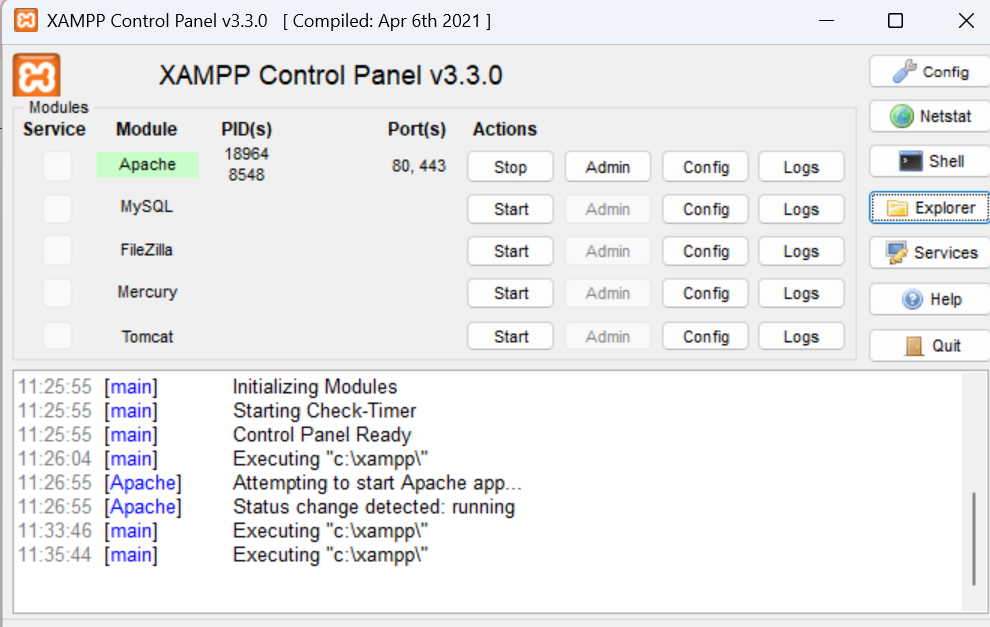


---

## 4. LANGKAH KERJA DAN HASIL PRAKTIKUM

### 4.1 Latihan 1. Menampilkan Teks dan Waktu Server

**Nama file:** `index.php`

**Langkah pengerjaan:**

1. Membuat file baru bernama `index.php`.
2. Menuliskan struktur dasar HTML.
3. Menambahkan tag PHP `<?php` dan `?>`.
4. Menggunakan perintah `echo` untuk menampilkan teks.
5. Menggunakan fungsi `date()` untuk menampilkan waktu server.
6. Menyimpan file.
7. Membuka browser dan mengakses:

`http://localhost/Lab7Web_PHP/index.php`

**Hasil praktikum:**

Program berhasil menampilkan judul halaman, pesan bahwa PHP berhasil dijalankan, dan waktu server.

**Dokumentasi:**

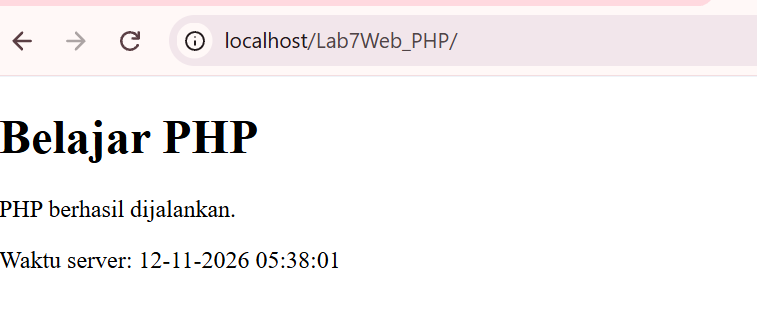

### 4.2 Latihan 2. Variabel, Operator, dan Percabangan

**Nama file:** `latihan2.php`

**Langkah pengerjaan:**

1. Membuat file `latihan2.php`.
2. Membuat variabel nama mahasiswa.
3. Membuat variabel nilai tugas, UTS, dan UAS.
4. Menghitung nilai akhir menggunakan operator aritmatika.
5. Menggunakan bobot nilai tugas 30%, UTS 30%, dan UAS 40%.
6. Menggunakan percabangan `if`, `elseif`, dan `else` untuk menentukan nilai huruf.
7. Menampilkan nama, nilai tugas, UTS, UAS, nilai akhir, dan nilai huruf.
8. Menyimpan file.
9. Membuka alamat:

`http://localhost/Lab7Web_PHP/latihan2.php`

**Hasil praktikum:**

Program berhasil menghitung nilai akhir mahasiswa berdasarkan bobot yang ditentukan dan menampilkan nilai huruf sesuai kondisi percabangan.

**Dokumentasi:**

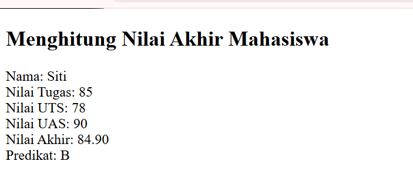

### 4.3 Latihan 3. Array dan Perulangan

**Nama file:** `latihan3.php`

**Langkah pengerjaan:**

1. Membuat file `latihan3.php`.
2. Membuat array yang berisi nama mahasiswa.
3. Menambahkan minimal tiga nama mahasiswa ke dalam array.
4. Menggunakan perulangan `foreach` untuk membaca setiap elemen array.
5. Menampilkan data mahasiswa dalam bentuk daftar HTML.
6. Menyimpan file.
7. Membuka alamat:

`http://localhost/Lab7Web_PHP/latihan3.php`

**Hasil praktikum:**

Program berhasil menampilkan seluruh nama mahasiswa yang tersimpan dalam array menggunakan perulangan `foreach`.

**Dokumentasi:**

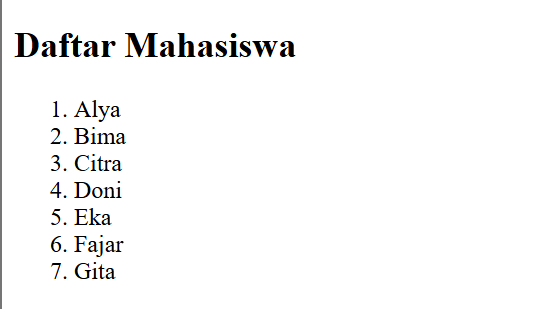

### 4.4 Latihan 4. Fungsi PHP

**Nama file:** `latihan4.php`

**Langkah pengerjaan:**

1. Membuat file `latihan4.php`.
2. Membuat fungsi `hitungDiskon($harga, $persen)`.
3. Menghitung potongan harga berdasarkan persentase diskon.
4. Menghitung harga setelah mendapatkan diskon.
5. Membuat fungsi tambahan `hitungLuas($panjang, $lebar)`.
6. Menghitung luas persegi panjang.
7. Menampilkan hasil perhitungan kedua fungsi.
8. Menyimpan file.
9. Membuka alamat:

`http://localhost/Lab7Web_PHP/latihan4.php`

**Hasil praktikum:**

Program berhasil menghitung harga setelah diskon dan luas persegi panjang menggunakan fungsi PHP.

**Dokumentasi:**

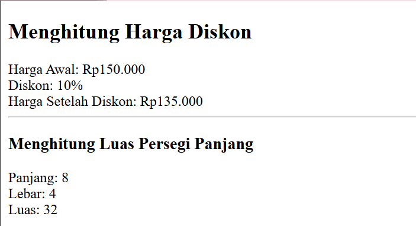

### 4.5 Latihan 5. Pengolahan Form dengan GET

**Nama file:** `latihan5.php`

**Langkah pengerjaan:**

1. Membuat file `latihan5.php`.
2. Membuat form HTML dengan input bernama `kata`.
3. Mengatur method form menggunakan `GET`.
4. Mengambil data menggunakan variabel superglobal `$_GET`.
5. Menggunakan `trim()` untuk menghapus spasi di awal dan akhir input.
6. Menggunakan `htmlspecialchars()` untuk mengamankan tampilan input.
7. Menampilkan kata yang dimasukkan pengguna.
8. Menyimpan file.
9. Membuka alamat:

`http://localhost/Lab7Web_PHP/latihan5.php`

10. Memasukkan kata pada form dan menekan tombol kirim.
11. Mengamati perubahan URL pada browser.

**Hasil praktikum:**

Program berhasil menerima dan menampilkan data menggunakan metode GET. Kata yang dimasukkan muncul sebagai parameter pada URL browser.

**Dokumentasi:**

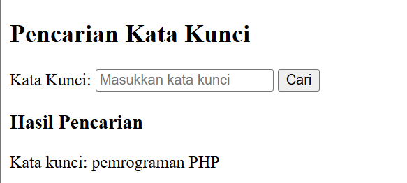

### 4.6 Latihan 6. Pengolahan Form dengan POST

**Nama file:** `latihan6.php`

**Langkah pengerjaan:**

1. Membuat file `latihan6.php`.
2. Membuat form dengan input nama dan program studi.
3. Mengatur method form menggunakan `POST`.
4. Mengambil data menggunakan variabel superglobal `$_POST`.
5. Memeriksa metode pengiriman menggunakan `$_SERVER["REQUEST_METHOD"]`.
6. Memeriksa apakah input sudah diisi.
7. Menampilkan pesan kesalahan jika input kosong.
8. Menggunakan `htmlspecialchars()` untuk mengamankan data sebelum ditampilkan.
9. Menyimpan file.
10. Membuka alamat:

`http://localhost/Lab7Web_PHP/latihan6.php`

11. Melakukan pengujian dengan data valid dan input kosong.

**Hasil praktikum:**

Program berhasil menerima data menggunakan metode POST. Program juga dapat memeriksa input kosong dan menampilkan data yang telah dimasukkan.

**Dokumentasi:**

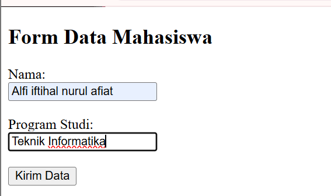 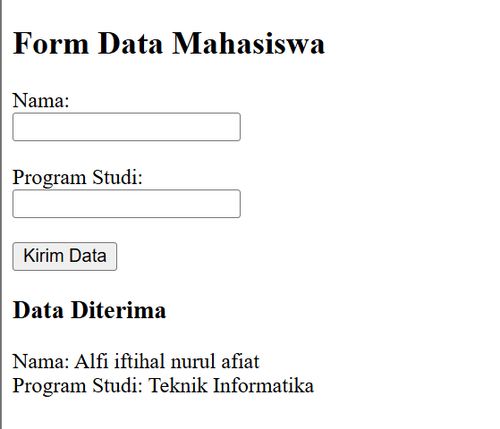

### 4.7 Latihan 7. Menghitung Subtotal Barang

**Nama file:** `latihan7.php`

**Langkah pengerjaan:**

1. Membuat file `latihan7.php`.
2. Membuat form dengan input nama barang, harga, dan jumlah.
3. Mengatur form menggunakan method `POST`.
4. Mengambil data dari `$_POST`.
5. Memeriksa nama barang agar tidak kosong.
6. Memvalidasi harga agar berupa angka dan tidak bernilai negatif.
7. Memvalidasi jumlah agar berupa bilangan bulat minimal satu.
8. Menghitung subtotal menggunakan rumus:

`Subtotal = Harga Barang × Jumlah Barang`

9. Menampilkan hasil subtotal dalam format Rupiah.
10. Menyimpan file.
11. Membuka alamat:

`http://localhost/Lab7Web_PHP/latihan7.php`

12. Menguji program menggunakan data valid dan tidak valid.

**Hasil praktikum:**

Program berhasil menghitung subtotal berdasarkan harga dan jumlah barang serta menampilkan pesan kesalahan jika input tidak sesuai.

**Dokumentasi:**

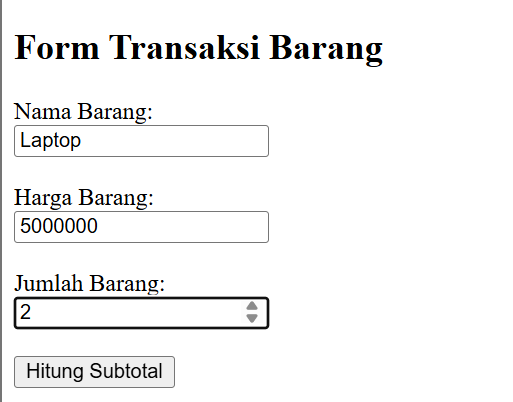 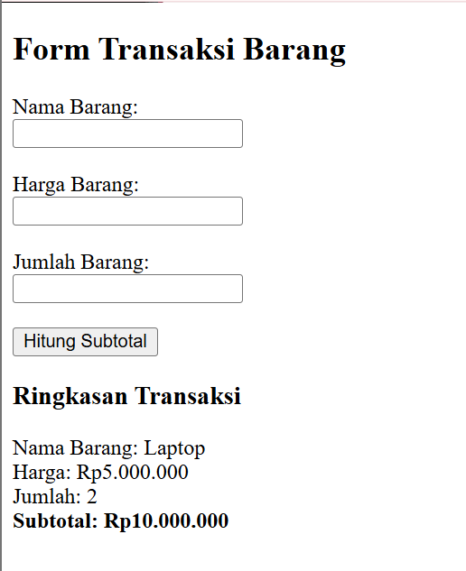

---

## 5. MINI PROJECT FORM DATA MAHASISWA

**Nama file:** `mini_project.php`

**Deskripsi:**

Mini project ini merupakan aplikasi formulir data mahasiswa menggunakan PHP. Formulir menerima nama, NIM, program studi, semester, dan email. Data dikirim menggunakan metode POST dan diperiksa melalui validasi server-side.

**Langkah pengerjaan:**

1. Membuat file `mini_project.php`.
2. Membuat form HTML dengan lima kolom input:
   - Nama.
   - NIM.
   - Program studi.
   - Semester.
   - Email.
3. Mengatur form menggunakan method `POST`.
4. Mengambil data menggunakan `$_POST`.
5. Memvalidasi nama agar tidak kosong.
6. Memvalidasi NIM agar tidak kosong.
7. Memvalidasi program studi agar dipilih.
8. Memvalidasi semester menggunakan `FILTER_VALIDATE_INT`.
9. Memastikan semester berada pada rentang 1 sampai 14.
10. Memvalidasi email menggunakan `FILTER_VALIDATE_EMAIL`.
11. Menampilkan pesan kesalahan jika data tidak valid.
12. Menampilkan data mahasiswa jika seluruh input valid.
13. Menggunakan `htmlspecialchars()` untuk mengamankan data yang ditampilkan.
14. Menyimpan file.
15. Membuka alamat:

`http://localhost/Lab7Web_PHP/mini_project.php`

### Pengujian Mini Project

**Pengujian 1. Input Valid**

Data yang dimasukkan:

- Nama: Andi
- NIM: 12345678
- Program Studi: Informatika
- Semester: 3
- Email: andi@gmail.com

Hasil yang diharapkan: Data mahasiswa berhasil ditampilkan.

**Pengujian 2. Nama Kosong**

Hasil yang diharapkan: Program menampilkan pesan bahwa nama wajib diisi.

**Pengujian 3. Semester Tidak Valid**

Input semester: 15.

Hasil yang diharapkan: Program menampilkan pesan bahwa semester harus berada pada rentang 1 sampai 14.

**Pengujian 4. Email Tidak Valid**

Input email: `andi123`.

Hasil yang diharapkan: Program menampilkan pesan bahwa format email tidak valid.

**Dokumentasi Mini Project:**

  

---

## 6. EKSPERIMEN

### 6.1 Eksperimen 1. Menghitung Rata-Rata Tiga Nilai

**Nama file:** `eksperimen1.php`

**Langkah pengerjaan:**

1. Membuat file `eksperimen1.php`.
2. Membuat tiga variabel nilai.
3. Menjumlahkan ketiga nilai.
4. Membagi hasil penjumlahan dengan angka tiga.
5. Menggunakan `number_format()` untuk mengatur jumlah angka desimal.
6. Menampilkan hasil rata-rata.
7. Menyimpan file.
8. Membuka alamat:

`http://localhost/Lab7Web_PHP/eksperimen1.php`

**Hasil praktikum:**

Dengan nilai 80, 85, dan 90, program menghasilkan rata-rata sebesar 85,00.

**Dokumentasi:**

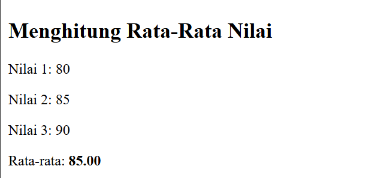 

### 6.2 Eksperimen 2. Pencarian Nama Mahasiswa Menggunakan GET

**Nama file:** `eksperimen2.php`

**Langkah pengerjaan:**

1. Membuat file `eksperimen2.php`.
2. Membuat array berisi nama mahasiswa.
3. Membuat form pencarian menggunakan method `GET`.
4. Mengambil kata kunci menggunakan `$_GET["nama"]`.
5. Menggunakan perulangan `foreach` untuk memeriksa nama mahasiswa.
6. Menggunakan fungsi `stripos()` untuk mencari kata kunci tanpa membedakan huruf besar dan kecil.
7. Menampilkan nama yang sesuai dengan kata kunci.
8. Menampilkan pesan jika nama tidak ditemukan.
9. Menyimpan file.
10. Membuka alamat:

`http://localhost/Lab7Web_PHP/eksperimen2.php`

11. Menguji pencarian nama Andi, huruf a, dan huruf Z.

**Hasil praktikum:**

Program berhasil mencari nama mahasiswa berdasarkan kata kunci yang dimasukkan melalui form GET.

**Dokumentasi:**

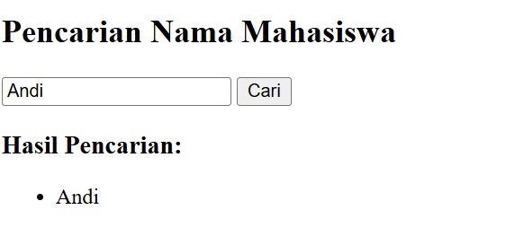

### 6.3 Eksperimen 3. Membuat Fungsi Format Rupiah

**Nama file:** `eksperimen3.php`

**Langkah pengerjaan:**

1. Membuat file `eksperimen3.php`.
2. Membuat fungsi `formatRupiah($angka)`.
3. Menggunakan fungsi `number_format()` untuk memisahkan angka ribuan.
4. Menambahkan awalan `Rp` pada hasil format.
5. Memanggil fungsi dengan beberapa contoh angka.
6. Menampilkan hasil format Rupiah.
7. Menyimpan file.
8. Membuka alamat:

`http://localhost/Lab7Web_PHP/eksperimen3.php`

**Hasil praktikum:**

Program berhasil mengubah angka menjadi format mata uang Rupiah. Contohnya, 150000 ditampilkan sebagai Rp 150.000.

**Dokumentasi:**

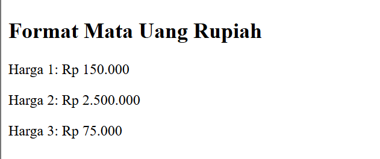

### 6.4 Eksperimen 4. Validasi NIM

**Nama file:** `eksperimen4.php`

**Langkah pengerjaan:**

1. Membuat file `eksperimen4.php`.
2. Membuat form input NIM menggunakan method `POST`.
3. Mengambil data NIM menggunakan `$_POST`.
4. Menggunakan `ctype_digit()` untuk memastikan NIM hanya berisi angka.
5. Menggunakan `strlen()` untuk memeriksa jumlah digit NIM.
6. Menentukan panjang NIM sebanyak delapan digit.
7. Menampilkan pesan sesuai hasil validasi.
8. Menyimpan file.
9. Membuka alamat:

`http://localhost/Lab7Web_PHP/eksperimen4.php`

10. Menguji beberapa input NIM.

**Hasil pengujian:**

| Input NIM | Hasil |
|---|---|
| 12345678 | NIM valid |
| 12345 | NIM harus terdiri dari 8 digit |
| 1234ABCD | NIM hanya boleh berisi angka |
| Kosong | NIM wajib diisi |

**Dokumentasi:**

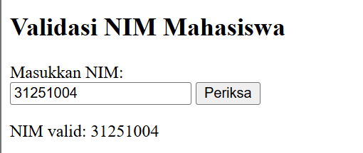

### 6.5 Eksperimen 5. Tombol Reset dan Proses Server

**Nama file:** `eksperimen5.php`

**Langkah pengerjaan:**

1. Membuat file `eksperimen5.php`.
2. Membuat form input nama menggunakan method `POST`.
3. Menambahkan tombol Kirim dengan tipe `submit`.
4. Menambahkan tombol Reset dengan tipe `reset`.
5. Membuat proses PHP untuk menerima data dari form.
6. Menampilkan pesan setelah data diproses server.
7. Menyimpan file.
8. Membuka alamat:

`http://localhost/Lab7Web_PHP/eksperimen5.php`
9. Mengisi nama kemudian menekan tombol Kirim.
10. Mengisi kembali nama kemudian menekan tombol Reset.
11. Mengamati perbedaan kedua tombol.

**Hasil praktikum:**

Tombol Reset mengembalikan input ke nilai awal langsung di browser. Tombol Kirim mengirim data ke server untuk diproses oleh PHP.

**Dokumentasi:**

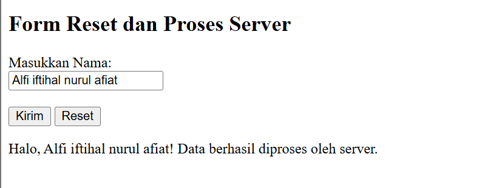

---

## 7. PEMBAHASAN

Berdasarkan latihan dan eksperimen yang telah dilakukan, terdapat beberapa konsep penting dalam pemrograman server-side PHP.

1. **Variabel dan Operator**

   Variabel digunakan untuk menyimpan data. Operator digunakan untuk melakukan operasi aritmatika dan perbandingan.

2. **Percabangan**

   Percabangan `if`, `elseif`, dan `else` digunakan untuk menjalankan perintah berdasarkan kondisi tertentu.

3. **Perulangan**

   Perulangan `foreach` digunakan untuk membaca setiap elemen dalam array.

4. **Fungsi**

   Fungsi digunakan untuk mengelompokkan perintah agar dapat dipanggil kembali sesuai kebutuhan.

5. **GET dan POST**

   GET mengirimkan parameter melalui URL. POST mengirimkan data melalui badan permintaan HTTP.

6. **Validasi Input**

   Validasi digunakan untuk memastikan data yang dimasukkan pengguna sesuai dengan aturan program.

7. **Sanitasi Output**

   `htmlspecialchars()` digunakan untuk mengubah karakter khusus HTML agar input pengguna tidak ditafsirkan sebagai kode HTML saat ditampilkan.

## 8. KESIMPULAN

Melalui Praktikum 7, mahasiswa mempelajari dasar pemrograman server-side menggunakan PHP. Materi yang dipelajari mencakup variabel, operator, percabangan, perulangan, array, fungsi, pengolahan form menggunakan GET dan POST, serta validasi dan sanitasi input.

Praktikum ini juga memberikan pengalaman dalam membuat aplikasi sederhana berupa form data mahasiswa. Dengan demikian, mahasiswa dapat memahami proses pengolahan data pada sisi server menggunakan PHP.

## 9. SOAL DAN JAWABAN EVALUASI

### 1. Apa perbedaan pemrograman client-side dan server-side?

**Jawaban:**

Pemrograman client-side merupakan pemrosesan kode yang berjalan pada browser pengguna. Contohnya adalah HTML, CSS, dan JavaScript. Pemrograman server-side merupakan pemrosesan kode yang berjalan pada server. Contohnya adalah PHP. Server memproses permintaan pengguna, kemudian mengirimkan hasilnya ke browser.

### 2. Mengapa PHP harus dijalankan melalui web server seperti Apache?

**Jawaban:**

PHP harus dijalankan melalui web server karena PHP merupakan bahasa pemrograman server-side. Apache menerima permintaan dari browser, meneruskan file PHP untuk diproses, kemudian mengirimkan hasil pemrosesan dalam bentuk halaman HTML kepada browser. Jika file PHP dibuka langsung dari penyimpanan komputer, kode PHP tidak akan diproses oleh server.

### 3. Apa fungsi tanda `$` dalam PHP?

**Jawaban:**

Tanda `$` digunakan untuk mendefinisikan dan mengakses variabel dalam PHP. Setiap nama variabel PHP harus diawali dengan tanda `$`.

Contoh:

```php
$nama = "Andi";
$umur = 20;

echo $nama;
echo $umur;
```

Pada contoh tersebut, `$nama` menyimpan data teks dan `$umur` menyimpan data angka.

### 4. Apa perbedaan metode GET dan POST dalam pengiriman data form?

**Jawaban:**

GET mengirimkan data melalui parameter URL sehingga data dapat terlihat pada alamat browser. GET biasanya digunakan untuk pencarian atau permintaan data.

POST mengirimkan data melalui badan permintaan HTTP sehingga data tidak ditampilkan sebagai parameter URL. POST sering digunakan untuk mengirim data formulir, seperti nama, NIM, dan email.

### 5. Mengapa validasi input harus dilakukan di sisi server?

**Jawaban:**

Validasi di sisi server diperlukan untuk memastikan data yang diterima sesuai dengan aturan program. Validasi ini tetap berjalan meskipun pengguna melewati atau menonaktifkan validasi pada browser. Dengan demikian, server dapat menolak data kosong, format yang salah, atau nilai yang tidak sesuai.

Contoh validasi pada PHP:

```php
if ($nama == "") {
    echo "Nama wajib diisi.";
}
```

### 6. Apa fungsi `htmlspecialchars()` dalam PHP?

**Jawaban:**

Fungsi `htmlspecialchars()` digunakan untuk mengubah karakter khusus HTML menjadi bentuk entitas HTML. Fungsi ini membantu mencegah input pengguna ditafsirkan sebagai kode HTML atau skrip ketika ditampilkan pada halaman web.

Contoh:

```php
$nama = "<script>alert('Halo')</script>";

echo htmlspecialchars($nama, ENT_QUOTES, 'UTF-8');
```

Dengan fungsi tersebut, teks input ditampilkan sebagai teks biasa dan tidak dijalankan sebagai kode HTML.

### 7. Mengapa fungsi atau function penting dalam pemrograman PHP?

**Jawaban:**

Fungsi penting karena membantu mengelompokkan kode berdasarkan tugas tertentu. Fungsi dapat digunakan kembali sehingga mengurangi penulisan kode yang berulang dan membuat program lebih terstruktur serta mudah dipelihara.

Contoh:

```php
function hitungLuas($panjang, $lebar) {
    return $panjang * $lebar;
}

echo hitungLuas(8, 4);
```

Hasil program adalah 32 karena fungsi menghitung luas persegi panjang dengan mengalikan panjang dan lebar.

---

## 10. DAFTAR PUSTAKA

1. PHP Documentation. PHP Manual. https://www.php.net/manual/en/
2. Apache Friends. XAMPP. https://www.apachefriends.org/

---

## 11. STRUKTUR FOLDER

```text
Lab7Web_PHP/
│
├── index.php
├── latihan2.php
├── latihan3.php
├── latihan4.php
├── latihan5.php
├── latihan6.php
├── latihan7.php
├── mini_project.php
├── eksperimen1.php
├── eksperimen2.php
├── eksperimen3.php
├── eksperimen4.php
├── eksperimen5.php
└── README.md
```
